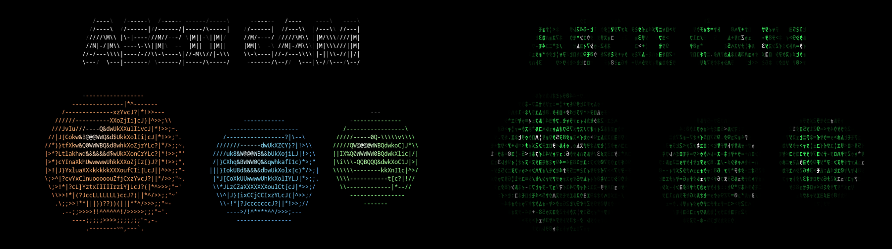

# ASCII-Matrix Cam - OBS Plugin

Turn your webcam (or any OBS source) into live **ASCII art**, **blocks** or falling **digital rain**.

There are two versions; use either or both:

| | What it is | Runs on |
|---|---|---|
| **OBS plugin** (`obs-plugin/`) | A video filter for OBS Studio, drawn on the GPU. Works on any source, and with OBS's Virtual Camera you can use it in Zoom, Meet, Discord or Teams. | Windows, Linux (OBS 30 or newer) |
| **Standalone app** (`app/`) | A small window showing your webcam live, with snapshots and copy-as-text. | Windows, Linux, macOS (Python) |

---

## OBS plugin

### Install on Windows

1. Download `ascii-matrix-cam-obs-windows-x64.zip` from the [latest release](../../releases/latest).
2. Close OBS.
3. Extract the zip into `C:\ProgramData\obs-studio\plugins\`. You should end up with
   `C:\ProgramData\obs-studio\plugins\ascii-cam\bin\64bit\ascii-cam.dll`.
   Create the `obs-studio\plugins` folders if they don't exist. `ProgramData` is hidden: paste the path
   into Explorer's address bar.
4. Start OBS.

### Install on Linux

1. Download `ascii-matrix-cam-obs-linux-x86_64.tar.gz` from the [latest release](../../releases/latest).
2. Extract it into your OBS plugins folder:
   - **OBS from your distro or the OBS PPA:**
     `mkdir -p ~/.config/obs-studio/plugins && tar xzf ascii-matrix-cam-obs-linux-x86_64.tar.gz -C ~/.config/obs-studio/plugins`
   - **OBS Flatpak:**
     `mkdir -p ~/.var/app/com.obsproject.Studio/config/obs-studio/plugins && tar xzf ascii-matrix-cam-obs-linux-x86_64.tar.gz -C ~/.var/app/com.obsproject.Studio/config/obs-studio/plugins`
3. Restart OBS.

### Use it

1. In OBS, right-click your camera (or any source) and choose **Filters**.
2. Under **Effect Filters**, click **+** and choose **ASCII Cam**.
3. Pick a style and adjust it:

| Setting | Does |
|---|---|
| Style | ASCII, Blocks or Matrix rain |
| Character size | Smaller means more detail |
| Draw edges | Draws outlines with `\| / - \` (ASCII style) |
| Colour | The source's own colours, or a single colour |
| Background | Colour and opacity; lower the opacity to lay the characters over the real video |
| Brightness / Contrast / Gamma | Tune for your lighting; lower gamma brightens dark rooms |
| Invert | Dense characters for dark areas, for a light background |

**In video calls:** click **Start Virtual Camera** in OBS, then choose **OBS Virtual Camera** as your
camera in Zoom, Meet, Discord or Teams.

**To uninstall,** delete the `ascii-cam` folder from the plugins folder.

### Build it yourself

- **Linux:** `obs-plugin/build.sh` builds and installs it for your user. It needs `gcc` plus either
  `libobs-dev` and `libsimde-dev` (Debian/Ubuntu) or the Flatpak OBS.
- **Windows:** the [GitHub Actions workflow](.github/workflows/build.yml) builds it with Visual Studio
  against OBS's headers and `obs.dll`. Fork the repo and the workflow builds it for you, or follow the
  same steps locally from a *Developer PowerShell for VS*.

`obs-plugin/make_atlas.py` renders the glyph strip the shader samples (`data/atlas.png`).

---

## Standalone app

### Install on Windows

1. Install [Python 3](https://www.python.org/downloads/). In the installer, tick **Add python.exe to PATH**.
2. On this page, click **Code** → **Download ZIP**, and extract it somewhere you'll keep it, such as `Documents`.
3. In the extracted folder, open `app` and double-click **`install-windows.bat`**. It installs PySide6 and
   numpy if needed, then adds an **ASCII Cam** icon to your desktop and Start menu.
4. Double-click **ASCII Cam** on your desktop.

If Windows shows "Windows protected your PC", click **More info** → **Run anyway**.

### Install on Linux

1. Click **Code** → **Download ZIP** (or `git clone` the repo), and extract it somewhere you'll keep it.
2. Install PySide6 and numpy, from your distro (`sudo apt install python3-pyside6.qtwidgets python3-pyside6.qtmultimedia python3-numpy`
   on Debian/Ubuntu, `sudo pacman -S pyside6 qt6-multimedia python-numpy` on Arch) or with `pip install -r app/requirements.txt`.
3. In a terminal in the extracted folder, run `app/install-linux.sh`. It adds **ASCII Cam** to your app menu and desktop.
4. Double-click **ASCII Cam** on your desktop. On KDE, choose **Allow / Execute** the first time.

If you move the folder, run the installer again. To remove the icons, run it with `--uninstall` (Linux) or
`-Uninstall` (Windows, from a terminal).

**macOS, or without the icon:** `pip install -r app/requirements.txt`, then `python3 app/ascii_cam.py`.

Options: `--cols 200` (more detail), `--camera 1` (another camera), and
`--still in.jpg out.png --mode Matrix` to convert one image without opening a window.

**Choppy when you lean in close?** Many webcams lower their frame rate in dim light (down to 7 fps),
and your face blocking the light is enough to trigger it. On Linux, tick **Steady 30 fps** in the app
to stop that; the camera's own setting is put back when you close the app. In OBS on Linux, the
*Video Capture Device (V4L2)* source's properties have the same switch: untick **Exposure, Dynamic
Framerate**. On Windows, look for **Low-light compensation** in your camera's settings or its
maker's app.

| Key | Does |
|---|---|
| Space | Save a snapshot PNG to `Pictures/ASCII Cam` |
| Ctrl+C | Copy the current frame as text |
| M | Next style (ASCII, Blocks, Matrix) |
| E | Edge characters on/off |
| H | Hide the controls |
| F11 / Esc | Fullscreen / leave fullscreen |

## How it works

- **Image, not text.** Every character is drawn once into a tile. Each frame is a lookup into those tiles
  (numpy in the app, a pixel shader in OBS), fast enough for live video at hundreds of columns.
- **A measured ramp.** Characters are ordered by how much ink they really use in the font, so brightness
  steps are even.
- **Edge characters.** A gradient pass finds strong edges and draws them as `| / - \` along their
  direction, so outlines read as lines.
- **No shimmer** (app). Contrast adapts smoothly and each cell only changes once it has really changed,
  so camera noise doesn't make characters flicker.
- **Digital rain.** Mirrored half-width katakana fall at random speeds with bright heads. The picture
  sets how bright the rain is, so you show up in it.

## License and credits

GPL-2.0-or-later (see [LICENSE](LICENSE)), as is usual for OBS plugins, since they link to libobs.

- The glyphs in `obs-plugin/data/atlas.png` are rendered from
  [Noto Sans Mono and Noto Sans CJK](https://fonts.google.com/noto), under the SIL Open Font License 1.1.
- The app uses [PySide6](https://doc.qt.io/qtforpython/) (LGPL-3.0) and [numpy](https://numpy.org/) (BSD).
- "Matrix rain" describes the falling-characters style. This project isn't affiliated with or endorsed
  by the owners of *The Matrix* films.
